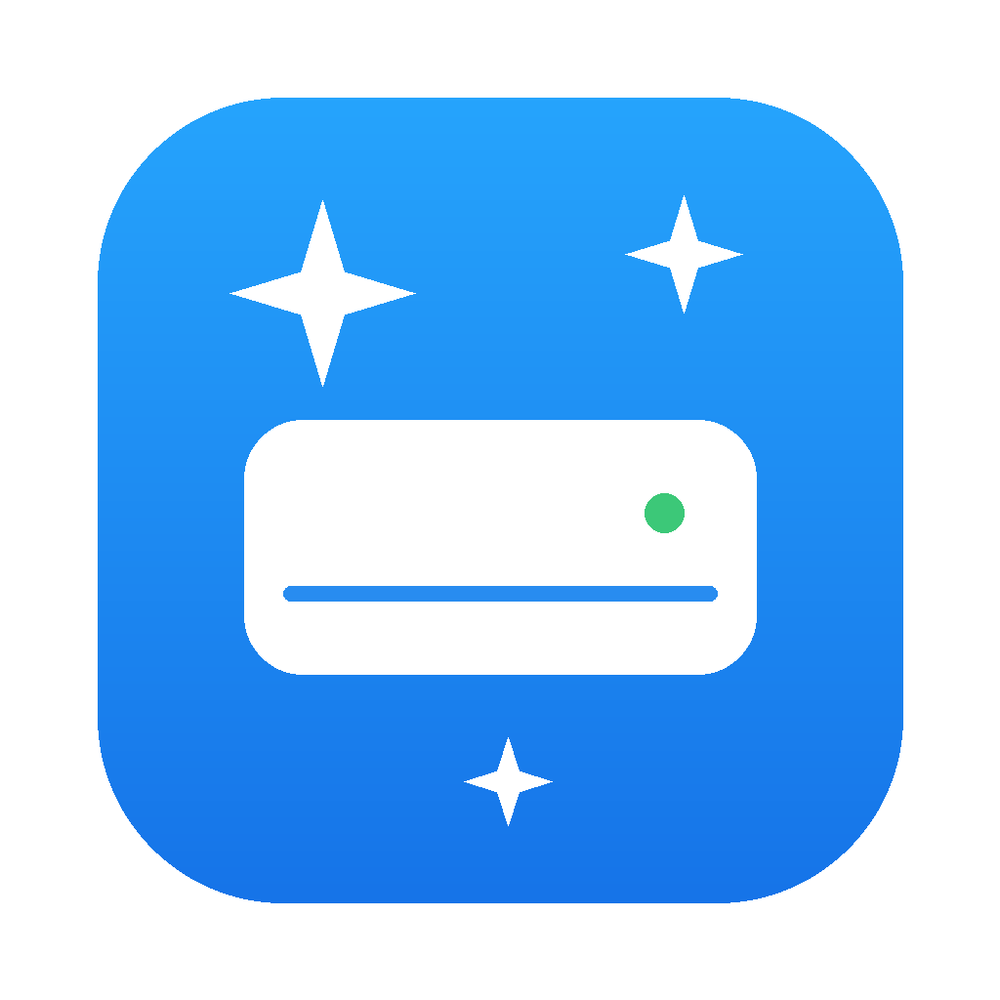
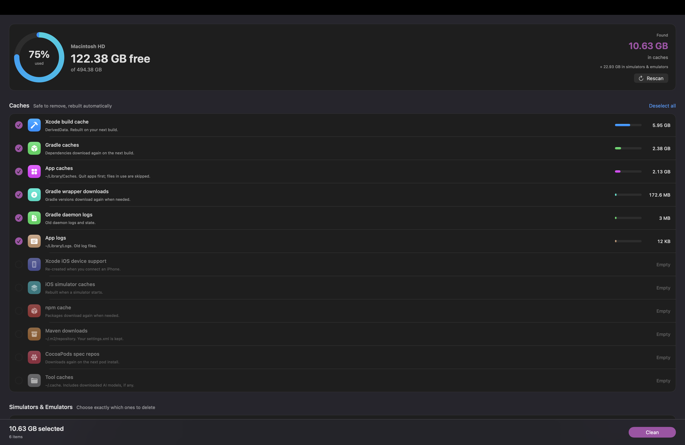
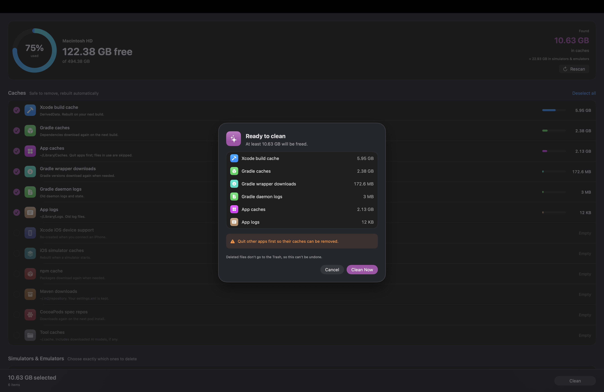

<p align="center">
  
</p>

<h1 align="center">SomAt Dev - Clean Mac Dev</h1>

<p align="center">
  A free, open-source Mac app that finds the caches, simulators and emulators filling up a developer's disk, and cleans exactly what you pick.
</p>

---

Xcode, Android Studio, Docker, Gradle, npm and friends quietly fill your disk with caches, old simulators and emulator images. macOS lumps all of it into **"System Data"**, which makes it hard to see where the space went. Clean Mac Dev shows you, with sizes, and lets you clean it in a couple of clicks.

## Screenshots





## Features

- **Disk overview**: how full your disk is, and how much the app found to free.
- **Safe caches pre-selected**: things that are rebuilt automatically are ticked for you; just press **Clean**.
- **Pick lists for big items**: choose individual iOS simulators, iOS runtimes, Android emulators and Android system images, each shown with its size.
- **Docker support**: shows what Docker can free, and can start Docker Desktop for you.
- **Review before deleting**: a summary lists every item and size, with warnings for anything that loses data.
- **Live progress** on each item, then a result screen with how much space was freed.
- **Safe by design**: it only deletes inside your home folder, never system files.

## What it cleans

| Category | Items | Safe? |
|---|---|---|
| Xcode | DerivedData, iOS DeviceSupport, simulator caches | ✅ Rebuilt automatically |
| JavaScript | npm cache, pnpm unused packages | ✅ Downloaded again when needed |
| Android / Java | Gradle caches, wrapper downloads, daemon logs, Maven `~/.m2/repository` | ✅ Downloaded again when needed |
| iOS | CocoaPods spec repos | ✅ Downloaded again on `pod install` |
| General | `~/.cache`, `~/Library/Caches`, `~/Library/Logs` | ✅ Rebuilt by apps |
| Homebrew | Old versions and downloads | ✅ |
| Docker | Stopped containers, unused images, build cache (volumes kept) | ⚠️ You confirm |
| iOS simulators & runtimes | Individual devices and whole iOS versions | ⚠️ You pick each one |
| Android emulators & system images | Individual AVDs and SDK system images | ⚠️ You pick each one |
| Trash | Empties the Trash through Finder | ⚠️ You confirm |

## Install

### Download

Get the latest `.dmg` or `.pkg` from [**Releases**](../../releases).

The release builds aren't signed with an Apple Developer ID, so macOS blocks them the first time. Open the app once, then go to **System Settings → Privacy & Security** and click **Open Anyway**.

### Build from source

You need macOS 13 or newer and Xcode (or the Command Line Tools: `xcode-select --install`).

```bash
git clone https://github.com/<your-account>/clean-mac-dev.git
cd clean-mac-dev
bash build.command
```

This compiles a universal app and puts `CleanMacDev-<version>.dmg` and `CleanMacDev-<version>.pkg` in `dist/`. Apps you build yourself open without any security warning.

If a **Developer ID Application** certificate is in your keychain, `build.command` signs with it automatically. To notarize as well, store your credentials once, then build again:

```bash
xcrun notarytool store-credentials CleanMacDev --apple-id YOUR_APPLE_ID --team-id YOUR_TEAM_ID
```

## Terminal version

Prefer the command line? [`scripts/clean-mac-dev.command`](scripts/clean-mac-dev.command) does the same job as an interactive menu:

```bash
bash scripts/clean-mac-dev.command
```

## Tips

- Quit Xcode, Android Studio, simulators and emulators before cleaning.
- Your first build or `npm install` after cleaning is slower while caches refill.
- Docker's disk image gives space back to macOS slowly. If it stays large, lower its size in Docker Desktop → **Settings → Resources**.

## Project structure

```
Sources/CleanMacDev/
├── App/        CleanMacDevApp.swift   app entry point and window
├── Core/       Shell, FileCleaner, Helpers   running tools, safe file deletion
├── Models/     AppModel (state), Catalog (what can be cleaned), CleanItem, DiskSpace
├── Services/   Scanner (finds simulators, emulators…), ToolRunner (runs cleanups)
└── Views/      one file per part of the window
```

To work on the app, open `Package.swift` in Xcode and press Run. To build the installable app, run `bash build.command`.

## Contributing

Issues and pull requests are welcome. To support a new cache folder, add one `cache(...)` line to [`Models/Catalog.swift`](Sources/CleanMacDev/Models/Catalog.swift).

## License

[MIT](LICENSE) © 2026 SomAt Dev
